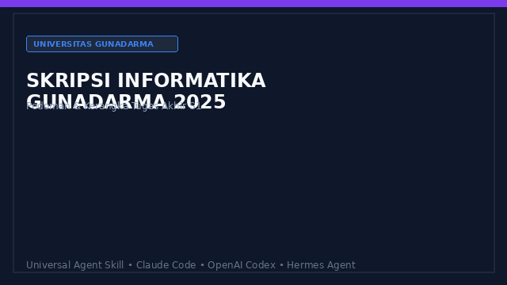

# Skill Skripsi Informatika Gunadarma




AI coding agent skill for writing, structuring, and auditing the undergraduate thesis (Skripsi) of the Informatics Study Program at Gunadarma University, based on the official 2025 guidelines. Compatible with Claude Code, OpenAI Codex, and Hermes Agent.

Read the full rule specification in [`SKILL.md`](SKILL.md).

> **Khusus Skripsi, bukan Penulisan Ilmiah (PI).** Skripsi adalah karya ilmiah akhir jalur Tugas Akhir semester 8 untuk gelar Sarjana Informatika (S1). Untuk PI, gunakan skill pedoman PI yang terpisah.

## Workflow Architecture

```text
+-------------------------------------------------------------+
| Manuscript (Draft DOCX / LyX / LaTeX / Rendered PDF)        |
+------------------------------|------------------------------+
                               |
                               v
+-------------------------------------------------------------+
| Gunadarma Skripsi 2025 Skill Engine                         |
|                                                             |
|  [Structure]   : Bagian awal, 5 bab isi, bagian akhir       |
|  [Content]     : Bab 1-5 per subbab (min. 3 paragraf)       |
|  [Sources]     : 20 sumber, 70% artikel ilmiah, Harvard+DOI |
|  [Visuals]     : Caption, tabel 3-garis, UML, lampiran kode |
|  [Ethics]      : 5 sifat etika, 6 pelanggaran               |
|  [Conflicts]   : Konflik pedoman dan contoh lampiran        |
+------------------------------|------------------------------+
                               |
                               v
+-------------------------------------------------------------+
| Structured Evidence-Led Audit Report                        |
|   - Status: sesuai / tidak sesuai / belum diuji / ambigu    |
|   - Evidence: Exact line, guideline page, and action item   |
+-------------------------------------------------------------+
```

## Mulai di sini

Siapkan naskah Skripsi versi terakhir. Untuk audit isi dan format yang lengkap, sertakan file sumber (misalnya DOCX atau LyX/LaTeX), PDF hasil render, dan PDF pedoman resmi. Kalau hanya ada teks, agent bisa memeriksa isi, tetapi tidak boleh memastikan margin, font, posisi caption, atau nomor halaman. Jangan kirim identitas pribadi yang tidak diperlukan.

1. Pasang skill lewat petunjuk di bawah, lalu mulai sesi agent baru.
2. Berikan berkas yang tersedia dan pilih salah satu contoh permintaan.
3. Periksa laporan: tiap temuan harus punya lokasi di naskah, halaman pedoman, status, dan tindakan. Lihat [contoh laporan fiktif](examples/contoh-audit.md).

## Pasang skill

Salin `SKILL.md` bersama seluruh `references/`. Pilih satu target direktori sesuai agent yang kamu pakai:

```sh
git clone git@github.com:azrahudaya/skill-skripsi-informatika-gunadarma.git
cd skill-skripsi-informatika-gunadarma
SKILL=skill-skripsi-informatika-gunadarma

# Claude Code
DEST="$HOME/.claude/skills/$SKILL"

# OpenAI Codex
# DEST="$HOME/.agents/skills/$SKILL"

# Hermes Agent
# DEST="$HOME/.hermes/skills/productivity/$SKILL"

mkdir -p "$DEST/references"
cp SKILL.md "$DEST/"
cp -R references/. "$DEST/references/"
```

Mulai sesi baru agar agent mengenali skill. PDF pedoman resmi universitas tidak disertakan di dalam repository ini. Berikan file PDF resmi secara mandiri jika memerlukan audit kutipan dan tata letak yang presisi.

## Contoh permintaan

- **audit format:** "Pakai skill skill-skripsi-informatika-gunadarma untuk audit format dan isi naskah Skripsi ini. Ini DOCX, PDF hasil render, dan PDF pedoman 2025. Buat matriks aturan, status, bukti lokasi naskah, halaman pedoman, dan tindakan. Tandai yang belum bisa diuji."
- **kerangka Skripsi:** "Bantu buat kerangka Skripsi Informatika untuk topik [topik] berdasarkan pedoman 2025. Pisahkan aturan wajib dari contoh, dan jangan buat hasil penelitian atau sumber pustaka fiktif."
- **Bab per bab:** "Susun kerangka Bab 3 Metode Penelitian untuk penelitian [topik] dengan pendekatan CRISP-DM. Sertakan subbagian data, pra-pemrosesan, model, evaluasi, dan perangkat."
- **Penelitian terdahulu:** "Buat tabel perbandingan penelitian terdahulu untuk Bab 2. Verifikasi tiap metode dan hasil dari artikel asli. Tandai artikel yang teks lengkapnya belum dibaca."
- **Pustaka:** "Periksa daftar pustaka saya: apakah sudah 20 sumber, 70% artikel ilmiah, format Harvard, dan DOI lengkap? Jangan buat sitasi fiktif."
- **LaTeX / LyX:** "Bantu buatkan template LaTeX main.tex untuk skripsi Gunadarma sesuai pedoman 2025 dengan margin 4-3-4-3 cm dan format Harvard."
- **Sidang & revisi:** "Bantu siapkan materi 12 slide presentasi sidang skripsi Informatika dan buatkan tabel matriks revisi pascasidang berdasarkan catatan penguji."
- **Etika:** "Periksa naskah ini terhadap lima sifat etika penulisan dan tandai indikasi enam pelanggaran bila ada, dengan bukti lokasi."

Hasil audit memakai status `sesuai`, `tidak sesuai`, `belum dapat diuji`, atau `pedoman ambigu`. [Alur audit](references/alur-audit.md) menjelaskan arti status dan bukti yang diperlukan. [Daftar konflik pedoman](references/ketidakselarasan.md) mencegah contoh lampiran dibaca sebagai aturan baru. Contoh keluaran bukan sertifikat kelulusan.

## Pemeriksaan paket

```sh
python3 scripts/validate.py
python3 -m unittest discover -s tests -v
```

Pemeriksaan ini menguji kelengkapan paket dan kontrak dokumentasi, bukan menjamin agent mengaudit naskah secara benar. [Skenario uji perilaku agent](tests/skenario-agent.md) tersedia untuk pengujian manual. Audit nyata tetap memerlukan naskah, sumber, render visual, dan pemeriksaan manusia.

## Hak penggunaan

Azra Hudaya belum menetapkan lisensi penggunaan ulang untuk teks skill ini (`license: Proprietary`). Ketersediaan repo secara publik dan petunjuk pemasangan bukan pernyataan izin untuk memakai ulang, memodifikasi, atau mendistribusikan teks skill. Hubungi pemilik untuk meminta izin atau menanyakan ketentuannya. PDF pedoman universitas tidak disertakan dan tidak dilisensikan ulang di sini. Periksa prosedur terbaru di kanal resmi Prodi sebelum menyerahkan data atau berkas.

Dibuat oleh [Azra Hudaya](https://github.com/azrahudaya).
